<div align="center">



<br/>

<a href="https://mashood-dev-portfolio.vercel.app/">
  
</a>
&nbsp;
<a href="https://www.linkedin.com/in/mahammad-mashood">
  
</a>
&nbsp;
<a href="https://github.com/mashood17">
  
</a>
&nbsp;
<a href="https://www.instagram.com/mashooood_/">
  
</a>

<br/><br/>


</div>

---

<table>
<tr>
<td width="66%" valign="top">

## `01` — WHO I AM

I'm **Mahammad Mashood**, an **AI & Software Engineer** based in Bengaluru, India.

I build **AI-powered applications, full-stack products, backend systems, and interactive digital experiences** with a focus on practical engineering, clean interfaces, reliable architecture, and meaningful functionality.

My work combines **AI and LLM integration, frontend engineering, backend development, database design, and modern web technologies** to turn ideas into working products.

I enjoy working across the complete development lifecycle — from understanding a problem and designing a solution to implementation, testing, optimization, and deployment.

<br/>

**Currently focused on**

`AI & LLM Engineering` · `Full-Stack Development` · `Backend Engineering` · `Interactive 3D` · `System Design`

</td>
<td width="34%" valign="top" align="center">


<br/><br/>

🟢 **AI & SOFTWARE ENGINEER**

<br/>

`Bengaluru, India · IST`

<br/>

<a href="https://mashood-dev-portfolio.vercel.app/">
  **Explore My Portfolio ↗**
</a>

</td>
</tr>
</table>

---

## `02` — WHAT I BUILD

<table>
<tr>
<td width="25%" align="center">

### 🤖

**AI & LLM**

AI-powered applications, LLM integrations, and intelligent workflows.

</td>
<td width="25%" align="center">

### ⚡

**FULL-STACK**

Modern web applications with frontend, backend, APIs, and databases.

</td>
<td width="25%" align="center">

### 🌐

**INTERACTIVE 3D**

Immersive web experiences, 3D visualizations, and motion-driven interfaces.

</td>
<td width="25%" align="center">

### ⚙️

**ENGINEERING**

Authentication, real-time systems, testing, performance, and deployment.

</td>
</tr>
</table>

---

## `03` — SELECTED WORK

### ELATŌ
**Premium hospitality · digital experience · administration**

A digital platform bringing together café, stay, events, and hospitality experiences. The project also includes administrative capabilities for managing website content and digital menu information.

`React` `Python` `Supabase` `Responsive UI` `Admin Dashboard`

**[↗ Live Website](https://www.elatogroups.in/)**

**[↗ Repository](https://github.com/mashood17/product-1)**

---

### CampusLoop
**Real-time campus platform · full-stack engineering**

A full-stack campus platform designed to connect students through real-time communication and modern digital workflows.

`React` `Python` `Flask` `PostgreSQL` `WebSockets` `JWT`

**Engineering validation**

- `72ms` average response time in reported load testing
- `50` concurrent users tested
- `0%` reported failures in that test
- `21` automated tests · `100%` pass rate

**[↗ Live Demo](https://campus-loop-pi.vercel.app/)**

**[↗ Repository](https://github.com/mashood17/campus_loop)**

---

### AI Timesheet Processor
**Document processing · AI-assisted workflows · automation**

An application designed to extract information from handwritten monthly timesheets and populate a master Excel workflow using employee identifiers.

`Python` `FastAPI` `AI/OCR Workflow` `Excel Automation`

**[↗ Repository](https://github.com/mashood17/ai-timesheet-processor)**

---

### Student AI Hub
**AI tools · student productivity · LLM integration**

An AI-powered student platform bringing multiple AI capabilities into a focused experience for academic assistance and useful student workflows.

`React` `Python` `LLM APIs` `AI Integration`

**[↗ Live Demo](https://frontend-k5qm.onrender.com/)**

**[↗ Repository](https://github.com/mashood17/student-ai-hub)**

---

### GitInsights
**Developer tools · GitHub data · repository insights**

A developer-focused project designed to present GitHub activity and repository information as useful development insights.

`JavaScript` `GitHub API` `Data Visualization`

**[↗ Live Demo](https://gitinsight-lake.vercel.app/)**

**[↗ Repository](https://github.com/mashood17/gitinsight)**

---

## `04` — ENGINEERING STACK

<table>
<tr>
<td valign="top" width="33%">

**AI & LLM ENGINEERING**

`OpenRouter`

`Cerebras`

`LLaMA`

`Ollama`

`Claude (Anthropic)`

`OpenAI Codex`

`Prompt Engineering`

`LLM API Integration`

`AI Application Development`

</td>
<td valign="top" width="33%">

**PROGRAMMING LANGUAGES**

`Python`

`JavaScript ES6+`

`SQL`

`TypeScript`

<br/>

**FRONTEND ENGINEERING**

`React.js`

`Tailwind CSS`

`Framer Motion`

`GSAP`

`Three.js`

`WebGL`

`HTML5`

`CSS3`

`Responsive Design`

</td>
<td valign="top" width="33%">

**BACKEND ENGINEERING**

`Node.js`

`Express.js`

`Flask`

`FastAPI`

`REST APIs`

`WebSockets`

`Flask-SocketIO`

`API Integration`

<br/>

**DATABASES**

`PostgreSQL`

`MongoDB`

`MySQL`

`Supabase`

`Firebase`

</td>
</tr>

<tr>
<td valign="top">

**SECURITY & AUTHENTICATION**

`JWT Authentication`

`Access / Refresh Tokens`

`Token Rotation`

`Axios Interceptors`

`OTP Authentication`

`Row-Level Security`

</td>
<td valign="top">

**TESTING & DEVOPS**

`Pytest`

`Locust`

`Docker`

`Git`

`GitHub`

`GitHub Actions`

`Postman`

`Linux`

`Vercel`

`Render`

`Railway`

</td>
<td valign="top">

**ANDROID DEVELOPMENT**

`Kotlin`

`Java`

`Android Studio`

`XML Layouts`

`RecyclerView`

`ViewBinding`

`Firebase Authentication`

`Cloud Firestore`

</td>
</tr>
</table>

---

## `05` — GITHUB / LIVE SIGNALS

<div align="center">


<br/>


</div>

<br/>

<div align="center">

**Contribution activity**


</div>

> The contribution animation is generated by GitHub Actions and refreshed automatically on pushes to `main` and on a daily schedule.

---

## `06` — PROOF OF WORK

<div align="center">

<table>
<tr>
<td align="center">

### 72ms

<sub>Average response time</sub>

</td>
<td align="center">

### 50

<sub>Concurrent users tested</sub>

</td>
<td align="center">

### 0%

<sub>Reported test failures</sub>

</td>
</tr>
<tr>
<td align="center">

### 21

<sub>Automated tests</sub>

</td>
<td align="center">

### 100%

<sub>Test pass rate</sub>

</td>
<td align="center">

### 4+

<sub>Featured projects</sub>

</td>
</tr>
</table>

</div>

---

## `07` — RESEARCH

### Job Portal Website

**Journal of Emerging Technologies and Innovative Research (JETIR)**

`Volume 12` · `Issue 7` · `July 2025`

Research covering the design and implementation of a web-based job portal application.

- ISSN: `2349-5162`
- Published: `July 2025`
- Journal: `JETIR`

**[↗ Read Published Paper](https://www.jetir.org/view?paper=JETIRGX06045)**

---

## `08` — NOW

```text
01  BUILDING    → AI-powered applications and full-stack products

02  EXPLORING   → LLM integration and practical AI engineering

03  ENGINEERING → Backend systems, APIs and real-time applications

04  CREATING    → Interactive 3D experiences and modern web interfaces

05  IMPROVING   → System design, testing and performance optimization
```

---

<div align="center">

### LET'S BUILD SOMETHING USEFUL.

**AI Applications · Full-Stack Products · Intelligent Digital Experiences**

<br/>

<a href="https://mashood-dev-portfolio.vercel.app/">Portfolio</a>
&nbsp; · &nbsp;
<a href="https://www.linkedin.com/in/mahammad-mashood">LinkedIn</a>
&nbsp; · &nbsp;
<a href="https://github.com/mashood17">GitHub</a>
&nbsp; · &nbsp;
<a href="mailto:mashoodrenja17@gmail.com">Email</a>

<br/><br/>


<br/><br/>

<sub>Build with intent. Ship with care. Keep improving.</sub>

</div>
